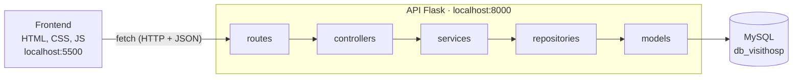

# VisitHosp

> Transformando a incerteza em cuidado e previsibilidade.

---

## Descrição do Projeto

O VisitHosp é um sistema de gestão de visitas para hospitais e seus visitantes.

**Objetivo:** sincronizar a agenda de visitas com o status clínico do paciente e com a lotação real do leito.

**Problema:** resolve a "viagem perdida" (visitas em horário de exame ou banho), o risco de infecção (com triagem digital), as falhas de segurança na entrada e a exposição de dados sensíveis do paciente (LGPD).

**Público-alvo:** hospitais de média e alta complexidade (gestão e enfermagem) e familiares e acompanhantes que buscam uma visita segura e previsível.

---

## Casos de Uso Implementados

São 20 casos de uso. Os de 1 a 10 formam a base do sistema; os de 11 a 20 foram acrescentados na versão final.

| Nº | Caso de uso | Onde aparece | Rota principal da API |
| :-- | :--- | :--- | :--- |
| 1 | Cadastro de pacientes | API | `/pacientes` |
| 2 | Triagem sanitária do visitante, com envio de documentos | Triagem (`token.html`) | `POST /uploads`, `/triagens` |
| 3 | Controle de ocupação dos leitos | API | `GET /leitos/{id}/disponibilidade` |
| 4 | Disponibilidade de visitas por horário | Agendamento (`inicial.html`) | `GET /internacoes/{id}/horarios` |
| 5 | Cadastro de internações | API | `/internacoes` |
| 6 | Controle de leitos e alta do paciente (cancela os acessos) | API | `/leitos`, `POST /leitos/{id}/dar-alta` |
| 7 | Cadastro e controle de visitas | Agendamento | `/visitas` |
| 8 | Geração de QR Code dinâmico da visita | Voucher (`qrcode.html`) | — |
| 9 | Regras de visita: bloqueio clínico, regras por papel, janela do QR e validação no totem | API | `GET /pacientes/{id}/bloqueio`, `POST /totem/validar-entrada` |
| 10 | Compartilhamento e impressão do QR Code | Voucher | — |
| 11 | Acessar o regulamento e os horários oficiais | Serviços › Regulamento | `GET /regulamento` |
| 12 | Consultar o status do paciente | Serviços › Status | `GET /pacientes/{id}/status` |
| 13 | Orientações de localização do leito | Serviços › Localização | `GET /leitos/{id}/localizacao` |
| 14 | Revogar o acesso do visitante | Painel › Visitantes e acessos | `POST /visitantes/{id}/revogar-acesso` |
| 15 | Alterar ou cancelar o agendamento | Serviços › Meus agendamentos | `POST /visitas/{id}/reagendar`, `POST /visitas/{id}/cancelar` |
| 16 | Ver os horários ocupados do mesmo leito | Serviços › Horários ocupados | `GET /leitos/{id}/horarios-ocupados` |
| 17 | Cadastro de visitante com vínculo a paciente e leito | Serviços › Cadastrar visitante | `POST /visitantes/cadastro-vinculado` |
| 18 | Relatório de histórico de visitas (com exportação CSV) | Painel › Histórico | `GET /relatorios/historico-visitas` |
| 19 | Auditoria de check-in e check-out | Painel › Auditoria | `GET /relatorios/auditoria-acessos`, `POST /visitas/{id}/checkin`, `POST /visitas/{id}/checkout` |
| 20 | Estatística de visitantes por turno | Painel › Visitantes por turno | `GET /relatorios/visitantes-por-turno` |

**Principais regras de negócio**

* No máximo 3 visitantes por horário em cada leito; horários de 30 minutos (09:00–11:00 e 14:00–16:00).
* Alteração e cancelamento só com pelo menos 60 minutos de antecedência e antes do check-in.
* Check-in permitido de 20 minutos antes até 30 minutos depois do horário agendado; permanência máxima de 60 minutos.
* Visitante com acesso revogado tem as visitas futuras canceladas e não consegue agendar nem se recadastrar para aquele paciente.
* Token de uma internação encerrada (alta) é recusado.

---

## Arquitetura

O frontend e a API são separados e conversam apenas por requisições HTTP com JSON. O frontend nunca acessa o banco.



| Camada | Pasta | Responsabilidade |
| :--- | :--- | :--- |
| Routes | `backend/routes/` | Liga cada URL e método HTTP a um controller |
| Controllers | `backend/controllers/` | Recebe a requisição, valida os campos e devolve a resposta em JSON |
| Services | `backend/services/` | Executa os casos de uso e as regras de negócio |
| Repositories | `backend/repositories/` | Faz as consultas ao banco com o SQLAlchemy |
| Models | `backend/models/` | Classes do ORM, uma por tabela |

### Estrutura de pastas

```
VisitHosp/
├── .env                    # credenciais do MySQL
├── frontend/
│   ├── index.html          # login com token de acesso
│   ├── inicial.html        # agendamento (calendário e horários)
│   ├── token.html          # triagem sanitária
│   ├── qrcode.html         # voucher com QR Code
│   ├── servicos.html       # serviços do visitante
│   ├── painel.html         # painel de gestão (enfermagem)
│   ├── script.js, voucher.js, servicos.js, config.js
│   └── *.css
└── backend/
    ├── app.py              # ponto de entrada da API
    ├── config.py           # conexão com o banco (lê o .env)
    ├── extensions.py       # objeto do SQLAlchemy
    ├── seed.py             # dados de demonstração
    ├── requirements.txt
    ├── routes/
    ├── controllers/
    ├── services/
    ├── repositories/
    ├── models/
    └── database/           # scripts SQL, criação do banco e seed
```

### Modelo de domínio

| Classe | Papel | Relacionamentos |
| :--- | :--- | :--- |
| `Paciente` | Paciente internado | 1:N com `Internacao` |
| `Leito` | Bloco, andar, ala e número do leito | 1:N com `Internacao` |
| `Internacao` | Liga paciente e leito; guarda o token de acesso | 1:N com `Visita` |
| `Visitante` | Pessoa que visita; guarda o aceite do termo LGPD | 1:N com `Visita` e com `VisitanteVinculo` |
| `Visita` | Agendamento com data, status e QR Code | Liga `Visitante`, `Internacao`, `Hospital` e `Triagem` |
| `Hospital` | Dados e horário de visita do hospital | 1:N com `Visita` |
| `Triagem` | Perguntas, respostas e resultado | 1:1 com `Visita` |
| `VisitanteVinculo` | Autorização do visitante para um paciente e leito; guarda a revogação | N:1 com `Visitante`, `Paciente` e `Leito` |
| `RegistroAcesso` | Check-in e check-out de cada visita | N:1 com `Visita` |

---

## Tecnologias Utilizadas

* **Frontend:** HTML, CSS e JavaScript (fetch API), com a biblioteca qrcodejs para o QR Code
* **Backend:** Python, Flask, Flask-SQLAlchemy (ORM) e Flask-Cors
* **Banco de dados:** MySQL (acesso com PyMySQL)
* **Ferramentas:** Git e GitHub, Figma, Draw.io e MySQL Workbench

---

## Como Executar o Projeto

### Pré-requisitos

* Python 3.10 ou mais recente
* MySQL Server 8 instalado e em execução

### 1. Configurar o banco

Na raiz do projeto, confira o arquivo `.env` com os dados do seu MySQL:

```
DB_USER=root
DB_PASSWORD=sua_senha
DB_HOST=localhost
DB_NAME=db_visithosp
```

Não é preciso criar o banco nem rodar scripts SQL: ao iniciar, a API cria o banco `db_visithosp` e as tabelas sozinha e, se o banco estiver vazio, carrega dados de demonstração.

### 2. Iniciar a API (terminal 1)

**Windows:**

```
cd backend
python -m venv venv
venv\Scripts\activate
pip install -r requirements.txt
python app.py
```

**Mac / Linux:**

```
cd backend
python3 -m venv venv
source venv/bin/activate
pip install -r requirements.txt
python3 app.py
```

A API fica em `http://localhost:8000`. Na primeira execução, o terminal mostra os tokens de acesso de teste.

### 3. Iniciar o frontend (terminal 2)

```
cd frontend
python -m http.server 5500
```

Abra `http://localhost:5500/index.html` no navegador. Use a porta 5500 (ou o Live Server do VS Code): abrir o HTML direto pelo arquivo não funciona, porque o navegador bloqueia as chamadas à API.

### 4. Testar

| Token | Paciente | Resultado esperado |
| :--- | :--- | :--- |
| `A3F-7K2-9MX` | Carlos Eduardo Ribeiro | Acesso liberado |
| `B4C-8D3-1PQ` | Helena Martins Souza | Acesso liberado |
| `K9M-2X7-0AB` | José Antônio Pereira | Acesso liberado, mas com visitas suspensas (restrição clínica) |
| `M2N-4P8-5RT` | Luciana Ferreira Lima | Acesso liberado |
| `C5D-1E4-7RS` | Roberto Almeida Costa | Recusado: internação encerrada |

Páginas: `servicos.html` (serviços do visitante) e `painel.html` (painel de gestão).

### Recriar os dados de demonstração

Os dados de exemplo são criados com datas relativas ao dia. Para recriá-los (por exemplo, antes de uma apresentação), dentro de `backend`:

```
python seed.py --reset
```

O comando apaga todos os dados e pede confirmação (digite `SIM`).

### Problemas comuns

* **"O servidor MySQL não está respondendo":** inicie o serviço do MySQL (no Windows, o serviço `MySQL80`).
* **"Usuário ou senha incorretos":** confira `DB_USER` e `DB_PASSWORD` no `.env`.
* **Erro ao ativar o venv no PowerShell:** rode `Set-ExecutionPolicy -Scope CurrentUser RemoteSigned` e tente de novo.

---

## LGPD e Segurança

* Nenhum dado do paciente é exibido sem o token de acesso da internação.
* O cadastro de visitante exige o aceite do termo de consentimento, e a decisão fica registrada no banco (`visitante.termo_consentimento`).
* O CPF aparece mascarado no painel de gestão.
* O QR Code da visita é renovado a cada 8 segundos e expira em 15 minutos.

---

## Integrantes do Grupo e Funções

| Nome do Integrante | Função / Responsabilidade | Link (GitHub/LinkedIn) |
| :--- | :--- | :--- |
| **Ana Clara Matias** | Desenvolvedor Backend / DevOps | github.com/aclarette |
| **Clara Lima** | Analista de Banco de Dados / QA | github.com/claraliima |
| **Fernanda Pena Barbosa** | Scrum Master / Documentação | Fernanda Barbosa |
| **Gustavo Soares** | Desenvolvedor Frontend / UI Designer | github.com/gustarhs |
